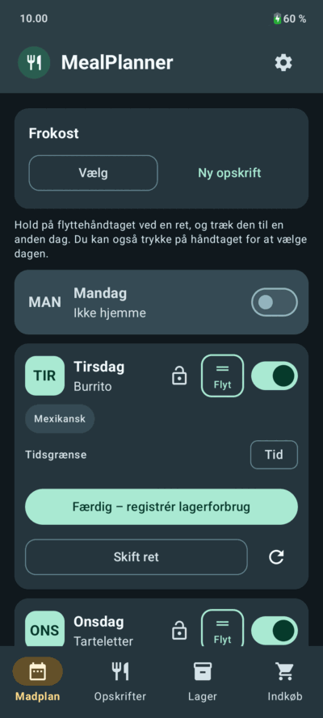
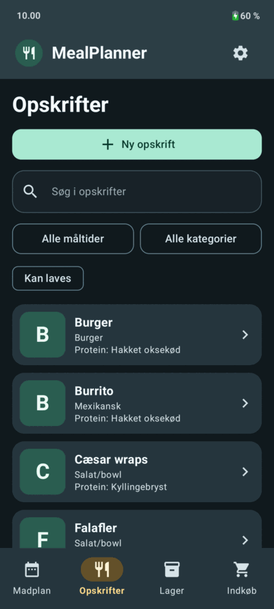
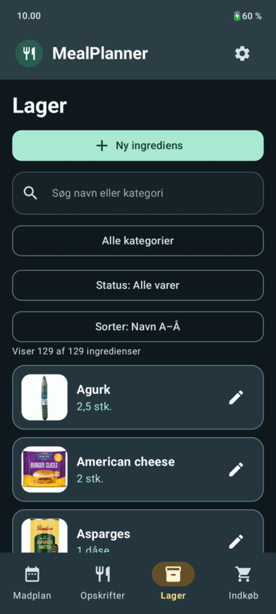
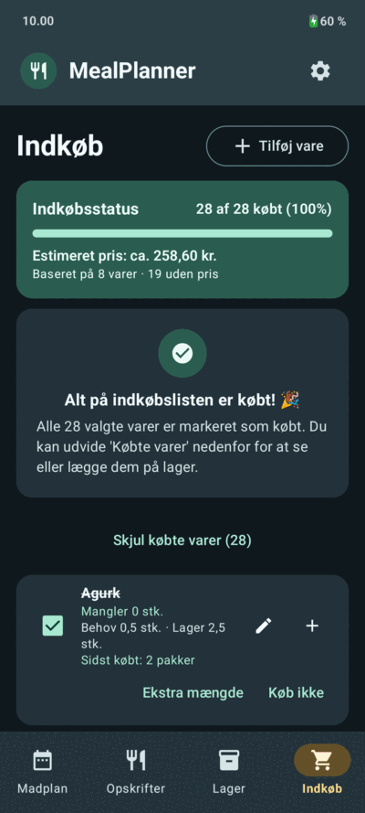

# MealPlanner

An Android app for planning the week's dinners with someone else. It builds a plan from your recipes
and what is already in the pantry, turns that into a shopping list, and keeps both phones in sync,
even when one of them has no signal.

The UI is in Danish, because it is built for a Danish household. The code, database and docs are in English.

<p>
  
  
  
  
</p>

<table>
  <tr>
    <td></td>
    <td></td>
    <td></td>
    <td></td>
  </tr>
  <tr>
    <td align="center">Plan</td>
    <td align="center">Recipes</td>
    <td align="center">Pantry</td>
    <td align="center">Shopping</td>
  </tr>
</table>

## What it does

The app has four tabs.

| Tab | What you do there |
|---|---|
| **Madplan** (plan) | See the week, lock days you are happy with, mark days you are away, drag a dinner to another day, and press *generate* to fill the rest. |
| **Opskrifter** (recipes) | Keep recipes with ingredients, numbered steps and sub-steps, photos, categories and a prep-time estimate. |
| **Lager** (pantry) | Track what is in the fridge and cupboards as real packages, with opened/sealed state and best-before dates. |
| **Indkøb** (shopping) | A shopping list worked out from the plan minus the pantry. Tick items off, add extras, and move bought items into the pantry. |

Parts of the code that are worth a look:

- **A planner that varies the week.** `WeeklyPlanner` scores whole weeks, not single days.
  It rewards recipes you can cook from stock, reuses ingredients across the week, and penalises
  repeats, back-to-back identical proteins and categories, and dishes eaten recently or often (it
  looks at the last 60 days). It runs a few hundred randomised trials, improves each with a local
  search, and then picks one of the candidate weeks at random, weighted by score, so you get variety
  instead of the same top pick every time. All weights are editable in the settings.
- **Offline first.** In a signed-in household, every change is written to a local Room database
  together with an outbox entry. WorkManager uploads the outbox when there is a connection, and
  Supabase Realtime brings the other phone's changes in. Most uploads are last-write-wins upserts.
  Edits to unit conversions carry an expected revision, so a stale edit is rejected, and a batch that
  is parked as a conflict can be resolved from the sync status page.
- **Unit handling.** One recipe says "2 tbsp", the shop sells 200 g packs and the pantry counts
  pieces. Amounts are stored in one base unit (g, ml, pieces, packs). Units of the same kind convert
  with fixed factors, but crossing between kinds needs a conversion the household has confirmed, such
  as "1 pack = 280 g", and the app does not guess one. Recipes keep the unit the author typed, so
  changing a product later does not rewrite old recipes.
- **Optional price lookup.** An Edge Function proxies a Danish grocery price API so the shopping
  list can show Bilka products, whole-pack counts and a rough price for the week. Each user's API key
  is sent once to be stored in Supabase Vault, and the app does not save it. See [docs/bilka-integration.md](docs/bilka-integration.md).

## How it is put together

```
┌────────────────────────── Android app (Kotlin, Compose) ──────────────────────────┐
│  Compose screens ──► MealPlannerState ──► rules (planner, pantry, quantities…)    │
│                            │                                                      │
│                            ▼                                                      │
│              Room: household snapshot + normalised rows + outbox                  │
│                            │                         ▲                            │
│                   WorkManager upload          Realtime events                     │
└────────────────────────────┼─────────────────────────┼────────────────────────────┘
                             ▼                         │
┌──────────────────────────── Supabase ───────────────────────────────────────────────┐
│  Auth · Postgres with row-level security · Storage (photos) · Realtime              │
│  Edge Functions: bilka-prej (JWT-protected)  ·  bilka-nightly-refresh (cron)        │
│  Vault (API keys) · pg_cron                                                         │
└─────────────────────────────────────────────────────────────────────────────────────┘
```

Most of the app's behaviour lives in small, pure `*Rules.kt` files that take values and return
values. They have no Compose or Android dependencies, which is why almost all of them have a plain
JVM unit test. More detail is in [docs/architecture.md](docs/architecture.md).

## Tech

- **App:** Kotlin, Jetpack Compose (Material 3), Room, WorkManager, Coil, kotlinx.serialization
- **Backend:** Supabase (Auth, Postgres + RLS, Storage, Realtime, Vault, pg_cron), Edge Functions in
  TypeScript on Deno
- **Build:** Gradle with a version catalog, AGP 9, KSP, R8 on for release builds
- **Tests:** JUnit and Robolectric for the app, Deno tests for the Edge Functions, SQL contract tests
  for the database
- **CI:** GitHub Actions builds and tests the app, checks the R8 mapping and DEX size, and type-checks
  and tests the Edge Functions

## Running it

You need a JDK (21 or newer) to start Gradle, the Android SDK and a Supabase project of your own.
Gradle downloads the JDK 25 that the build is configured for.

1. Create `local.properties` in the project root:

   ```properties
   sdk.dir=/path/to/Android/Sdk
   SUPABASE_URL=https://<your-project>.supabase.co
   SUPABASE_PUBLISHABLE_KEY=<your publishable (anon) key>
   ```

   Without the two Supabase values the project still compiles using placeholders, which is what CI
   does, but you cannot sign in.

2. Build and test:

   ```bash
   ./gradlew :app:testDebugUnitTest      # unit tests
   ./gradlew :app:assembleDebug          # debug APK, installs next to a release build
   ```

3. Edge Function tests (needs [Deno](https://deno.com)):

   ```bash
   deno test supabase/functions/bilka-prej/
   deno test supabase/functions/bilka-nightly-refresh/
   ```

> **Backend note.** The core tables (households, recipes, ingredients, weekly plans, pantry) are not
> in `supabase/migrations`, which only holds later changes. The folder is not enough to recreate the
> database from scratch yet.

## Repository layout

```
app/                     Android application
  src/main/java/…        screens, state, sync, rules
  src/test/java/…        JVM unit tests
  src/androidTest/…      Compose UI smoke test
  schemas/               exported Room schemas
macrobenchmark/          on-device startup and scroll benchmarks
supabase/
  functions/             Edge Functions and their Deno tests
  migrations/            SQL migrations
  tests/                 SQL contract tests (each rolls back)
scripts/                 release checks and signing helper
docs/                    architecture, price integration, releasing
```

## More

- [docs/architecture.md](docs/architecture.md): state, sync and the quantity model
- [docs/bilka-integration.md](docs/bilka-integration.md): price lookup, key handling, nightly refresh
- [docs/releasing.md](docs/releasing.md): R8, signing, deploy order
- [macrobenchmark/README.md](macrobenchmark/README.md): running the benchmarks
